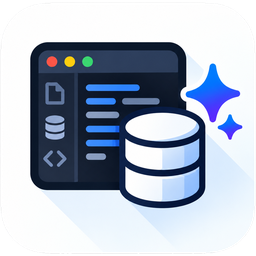

### Hi, I'm Sidhant 👋

Product Designer & Engineer in Delhi, and Senior Product Designer at BigDot. On the side I design, build and ship my own Mac apps, developer tools, web and mobile apps, solo.

### Mac apps

 **[MightyBench](https://mightybench.com/?ref=github)**: 49 private tools for video, audio, images, PDFs and on-device AI, in one native Mac app.

 **[FindGlance](https://findglance.com/?ref=github)**: Find files on your Mac by describing them in plain English, including text inside screenshots and PDFs.

 **[AgentKnocks](https://agentknocks.com/?ref=github)**: Menu-bar app that tells you when a Claude Code or Codex session needs you, finishes or fails.

 **[Pixtamer](https://github.com/heysidhant/pixtamer)**: Batch-convert, compress and resize images into web-ready JPEG, PNG, WebP and AVIF. Free and open source.

### Developer tools

 **[QueryMoat](https://querymoat.com/?ref=github)**: Safe database access for AI coding agents. Read-only by default, inside VS Code, Cursor and Windsurf. [Repo](https://github.com/heysidhant/querymoat) · [GitHub Action](https://github.com/marketplace/actions/querymoat-check)

 **[BoilerPrompt](https://boilerprompt.dev/?ref=github)**: Free library of copy-paste prompts for Cursor, Claude Code, v0, Lovable and more.

### Web apps

 **[EventPixel](https://eventpixel.app/?ref=github)**: AI photo sharing for events.

 **[FeedWing](https://feedwing.com/?ref=github)**: AI social media for small businesses: plan, write and schedule posts across channels.

 **[ATS First](https://atsfirst.com/?ref=github)**: Check how applicant tracking systems read your resume.

### Mobile apps

 **[DailyAbhyas](https://dailyabhyas.com/?ref=github)**: Daily practice for SSC CGL aspirants, with explanations in English and Hindi and revision of past mistakes.

### Elsewhere

[sidhantsinha.com](https://sidhantsinha.com) · [X @heysidhant](https://x.com/heysidhant) · [LinkedIn](https://www.linkedin.com/in/sidhantsinha) · [hi@sidhantsinha.com](mailto:hi@sidhantsinha.com)
